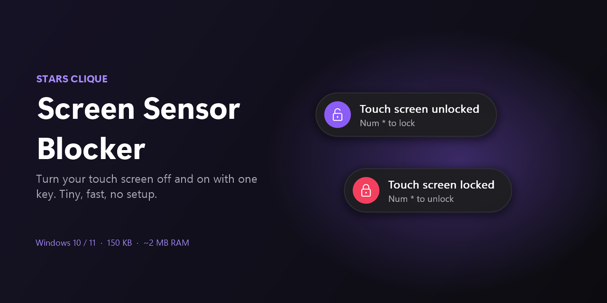
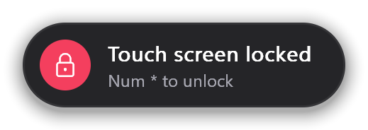
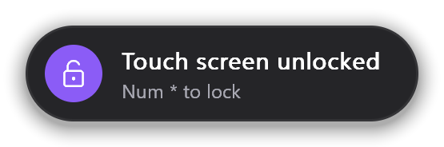
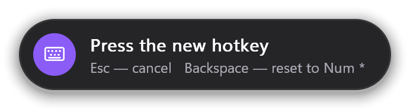

<p align="center">
  
</p>

<p align="center">
  <a href="https://github.com/9519860664r-oss/stars-clique-screen-sensor-blocker/releases/latest"></a>
  
  
  <a href="LICENSE"></a>
</p>

<p align="center">
  <b>English</b> · <a href="README.ru.md">Русский</a>
</p>

---

Lock your touch screen with one key, so a sleeve, a cat or a stray finger doesn't click anything. Press the key again to unlock it. A small notice shows you what happened.

## Features

- **One key.** `Num *` by default, which is **`Fn + *`** on many laptops without a number pad. You can pick any other key combination.
- **Lightweight.** 150 KB, about 2 MB of memory, 0% CPU while idle. The program sleeps until you press the key.
- **Clear notices.** A small card at the bottom of the screen tells you whether the sensor is now locked or unlocked.
- **Touch works on the sign-in screen.** The sensor is turned on for restart and locked again after you sign in. You can turn this off.
- **Touch screen only.** The touchpad, mouse and keyboard are never affected.
- **No setup.** It finds the touch screen by itself and starts with Windows.

<p align="center">
  
  
</p>

## Install

1. Download **`StarsClique-ScreenSensorBlocker-…-EN.zip`** from [Releases](https://github.com/9519860664r-oss/stars-clique-screen-sensor-blocker/releases/latest).
2. Extract the folder anywhere.
3. Run **`Install.cmd`** and click **Yes** when Windows asks for administrator rights.

That's it: the program is copied to `Program Files`, added to startup and started right away.

> **"Windows protected your PC"?** The program isn't code-signed. Click **More info → Run anyway**.
> Administrator rights are needed because Windows only lets admins turn devices on and off. The program asks for them once, at install, not on every start.

## How to use

| Action | What happens |
|---|---|
| `Num *` / `Fn + *` | Lock or unlock the touch screen |
| Left-click the tray icon | Same as the hotkey |
| Right-click the tray icon | Menu with settings and **Exit** |

The tray icon shows the current state: a screen with a violet dot means touch is on; a crossed-out screen means it's locked.

<p align="center">
  
  &nbsp;&nbsp;
  
</p>

## Settings

Right-click the tray icon:

- **Change hotkey…** Press the new combination. `Esc` cancels, `Backspace` resets to `Num *`. Keys that type text (letters, digits) need `Ctrl` or `Alt`, so the hotkey never gets in the way of typing.
- **Turn touch on when restarting** (on by default). Touch works on the Windows sign-in screen and gets locked again after you sign in. Turn it off if you want the sensor to stay locked through restarts.

<p align="center">
  
  <br>
  
</p>

## Uninstall

Run **`Uninstall.cmd`** from the same folder. The touch screen is turned back on, and the program, its startup entry and settings are removed.

## FAQ

**`Fn + *` doesn't work.**
On some keyboards `Fn` is handled inside the keyboard and Windows never sees it. Choose another combination in **Change hotkey…**, for example `Ctrl + Alt + T`.

**I quit the program and touch stayed locked.**
**Exit** in the tray menu always turns touch back on. If the process was killed some other way (Task Manager), run the program again and press the hotkey, or run `Uninstall.cmd`.

**Does it work with a pen / stylus?**
Only the touch screen device is switched. If your pen shares that device, it is locked too.

**Where are the settings stored?**
`HKEY_CURRENT_USER\Software\Stars Clique\Screen Sensor Blocker`.

## Build from source

You need Visual Studio Build Tools with the C++ workload (MSVC).

```bat
src\build.bat
```

This builds `bin\ru` and `bin\en`. `tools\package.ps1` builds both and packs the release zips into `dist\`.

The whole program is one C file ([`src/main.c`](src/main.c)) on plain Win32: no frameworks, no runtime to install.

## License

[PolyForm Noncommercial 1.0.0](LICENSE) © 2026 **Stars Clique**.

You may use, share and modify it for **non-commercial** purposes. Keep the author notice (`Required Notice: Copyright (c) 2026 Stars Clique`) in any copy. Commercial use is not allowed without permission.
