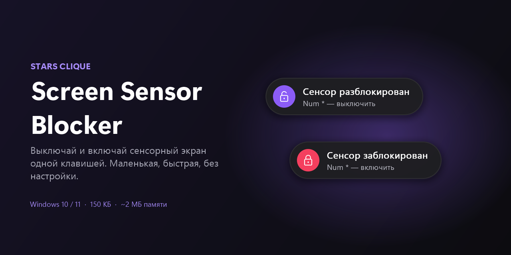
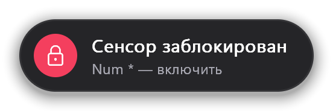
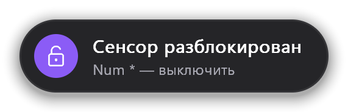
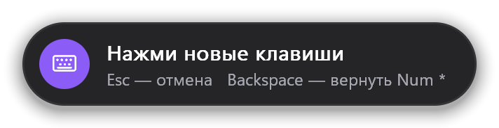
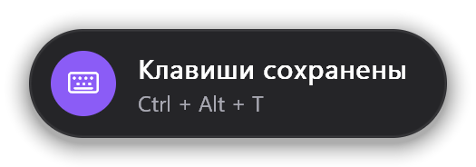

<p align="center">
  
</p>

<p align="center">
  <a href="https://github.com/9519860664r-oss/stars-clique-screen-sensor-blocker/releases/latest"></a>
  
  
  <a href="LICENSE"></a>
</p>

<p align="center">
  <a href="README.md">English</a> · <b>Русский</b>
</p>

---

Блокирует сенсорный экран одной клавишей, чтобы рукав, кот или случайное касание ничего не нажали. Нажми ещё раз, и сенсор снова работает. Небольшая плашка показывает, что произошло.

## Возможности

- **Одна клавиша.** По умолчанию `Num *`. На многих ноутбуках без цифрового блока это **`Fn + *`**. Можно поставить любое своё сочетание.
- **Лёгкая.** 150 КБ, около 2 МБ памяти, 0% процессора в простое. Программа спит, пока не нажмёшь клавишу.
- **Понятные уведомления.** Внизу экрана появляется плашка: сенсор заблокирован или разблокирован.
- **Сенсор работает на экране входа.** На время перезагрузки сенсор включается, а после входа в Windows снова блокируется. Это можно отключить.
- **Только сенсорный экран.** Тачпад, мышь и клавиатура не трогаются.
- **Без настройки.** Сама находит сенсорный экран и запускается вместе с Windows.

<p align="center">
  
  
</p>

## Установка

1. Скачай **`StarsClique-ScreenSensorBlocker-…-RU.zip`** в разделе [Releases](https://github.com/9519860664r-oss/stars-clique-screen-sensor-blocker/releases/latest).
2. Распакуй папку куда угодно.
3. Запусти **`Установить.cmd`** и нажми **«Да»**, когда Windows спросит права администратора.

Готово: программа скопируется в `Program Files`, добавится в автозапуск и сразу запустится.

> **«Система Windows защитила ваш компьютер»?** У программы нет цифровой подписи. Нажми **«Подробнее» → «Выполнить в любом случае»**.
> Права администратора нужны, потому что включать и выключать устройства в Windows может только администратор. Программа просит их один раз, при установке, а не при каждом запуске.

## Как пользоваться

| Действие | Что происходит |
|---|---|
| `Num *` / `Fn + *` | Заблокировать или разблокировать сенсор |
| Клик по значку в трее | То же, что клавиша |
| Правый клик по значку | Меню с настройками и кнопкой **«Выход»** |

Значок в трее показывает состояние: экран с фиолетовой точкой — сенсор работает, перечёркнутый экран — заблокирован.

<p align="center">
  
  &nbsp;&nbsp;
  
</p>

## Настройки

Правый клик по значку в трее:

- **«Сменить клавиши…»** Нажми новое сочетание. `Esc` — отмена, `Backspace` — вернуть `Num *`. Для клавиш, которые печатают текст (буквы, цифры), нужен `Ctrl` или `Alt`, чтобы сочетание не мешало набору.
- **«Включать сенсор при перезагрузке»** (включено по умолчанию). На экране входа в Windows сенсор работает, а после входа снова блокируется. Сними галочку, если сенсор должен оставаться заблокированным и после перезагрузки.

<p align="center">
  
  <br>
  
</p>

## Удаление

Запусти **`Удалить.cmd`** из той же папки. Сенсор включится, а программа, автозапуск и настройки удалятся.

## Вопросы

**`Fn + *` не срабатывает.**
На некоторых клавиатурах `Fn` обрабатывается внутри самой клавиатуры, и Windows его не видит. Выбери другое сочетание в **«Сменить клавиши…»**, например `Ctrl + Alt + T`.

**Я закрыл программу, а сенсор остался выключен.**
**«Выход»** в меню трея всегда включает сенсор обратно. Если процесс закрыли иначе (через Диспетчер задач), запусти программу снова и нажми клавишу или запусти `Удалить.cmd`.

**Работает ли с пером?**
Выключается только сенсорный экран. Если перо работает через то же устройство, оно тоже заблокируется.

**Где хранятся настройки?**
`HKEY_CURRENT_USER\Software\Stars Clique\Screen Sensor Blocker`.

## Сборка из исходников

Нужны Visual Studio Build Tools с компонентом C++ (MSVC).

```bat
src\build.bat
```

Соберутся `bin\ru` и `bin\en`. `tools\package.ps1` собирает обе версии и упаковывает архивы для релиза в `dist\`.

Вся программа — один файл на C ([`src/main.c`](src/main.c)) на чистом Win32: без фреймворков и без библиотек, которые надо ставить.

## Лицензия

[PolyForm Noncommercial 1.0.0](LICENSE) © 2026 **Stars Clique**.

Можно пользоваться, делиться и изменять в **некоммерческих** целях. В любой копии нужно сохранять указание автора (`Required Notice: Copyright (c) 2026 Stars Clique`). Коммерческое использование без разрешения запрещено.
